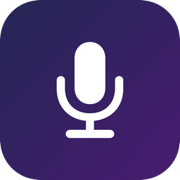

<p align="center">
  
</p>

<h1 align="center">Dictum</h1>

<p align="center"><em>"something spoken", "a uttered word" — Latin</em></p>

<p align="center">
  <a href="https://github.com/Nikoro/dictum/releases/latest"></a>
  <a href="https://github.com/Nikoro/dictum"></a>
  <!-- Keep Swift version in sync with SWIFT_VERSION in project.yml -->
  <a href="https://github.com/Nikoro/dictum"></a>
  <a href="LICENSE"></a>
</p>

Native macOS menu bar app for voice dictation. Converts speech to text and auto-pastes it into the active window. Fully on-device — no cloud, no network.

**Pipeline:** microphone → WhisperKit or Parakeet (CoreML, Neural Engine) → raw text → local LLM (MLX Swift) → cleaned text → auto-paste

## Requirements

| | Minimum |
|---|---|
| macOS | 26.0 (Tahoe) |
| Chip | Apple Silicon (M1+) |
| RAM | 16 GB (32 GB recommended) |
| Disk | ~5 GB for models |
| Xcode | 27.0+ (build only) |

## Stack

- **STT:** [WhisperKit](https://github.com/argmaxinc/argmax-oss-swift) 1.1.1 — large-v3-turbo, CoreML on Neural Engine; or Parakeet TDT v3 via [FluidAudio](https://github.com/FluidInference/FluidAudio) 0.18.0 — many times faster
- **LLM:** [MLX Swift LM](https://github.com/ml-explore/mlx-swift-lm) 3.32.3 — Gemma 4 E4B (default) with MTP speculative decoding, any mlx-community model
- **Audio:** AVAudioEngine — PCM Float32, 16kHz mono
- **Auto-paste:** CGEvent Cmd+V via Accessibility API
- **Updates:** [Sparkle](https://github.com/sparkle-project/Sparkle) 2.10.1+ — automatic updates from GitHub Releases

## Build

```bash
# XcodeGen and the lint tools, at the versions pinned in .mise.toml
mise install

# Generate Xcode project
xcodegen generate

# Open in Xcode and build (Cmd+R)
open Dictum.xcodeproj
```

> **Note:** Must be built with Xcode (`xcodebuild`), not `swift build` — MLX Swift compiles Metal shaders.

The project signs with the maintainer's Developer ID. Without that certificate, build ad-hoc signed:
`xcodebuild -scheme Dictum CODE_SIGN_IDENTITY=- DEVELOPMENT_TEAM= ENABLE_HARDENED_RUNTIME=NO build`.

Project commands live in `spells.yaml` and need [Spellbook](https://nikoro.github.io/spellbook/) (macOS only): install via `curl -sSfL https://raw.githubusercontent.com/Nikoro/spellbook/main/install.sh | sh`, then run `spells` in the project root to activate it.

## Permissions

On first launch, the onboarding flow guides you through:

1. **Microphone** — system prompts automatically
2. **Accessibility** — manual: System Settings → Privacy & Security → Accessibility → add Dictum

## Usage

1. Click the microphone icon in the menu bar to open the settings popover
2. Press the hotkey (default: hold `Right ⌘`) to start recording
3. Speak (language: Polish by default)
4. Release the key (hold mode) or press again (toggle mode) — press `Escape` to cancel
5. Text is automatically pasted into the active window (or copied to clipboard in context mode)

### Menu bar icon states

| Icon | State |
|------|-------|
| Template (rounded rect + mic cutout) | Idle / Warming up / Transcribing / Processing |
| Custom (mic + red dot) | Recording |

## Features

- **On-device pipeline** — WhisperKit or Parakeet STT + MLX LLM, no network required
- **Live transcription** — long dictations are transcribed in chunks while you speak, so the text is ready seconds after you stop
- **Dictionary** — fix words the recognizer always gets wrong
- **Microphone choice** — pick any input device; Bluetooth route changes are handled
- **Free memory after idle** — models unload after a chosen idle time and reload while you speak
- **LLM text cleanup** — optional post-processing to fix punctuation, grammar, formatting
- **Context-aware dictation** — select text before dictating to use it as LLM context; result is copied to clipboard instead of auto-pasted
- **Per-app prompts** — custom LLM prompts per application (matched by bundle ID), with `{{text}}` placeholder
- **General prompt toggle** — enable/disable the default system prompt independently
- **Model browser** — search and download models from HuggingFace (MLX community), manage downloaded models
- **Floating indicator** — translucent pill at the text cursor showing recording state and audio level
- **Configurable hotkey** — modifier-only (e.g. Right ⌘) or key+modifier combos
- **Hold / Toggle modes** — hold-to-record or press-to-start/press-to-stop
- **Onboarding** — guided setup: permissions → speech model download → optional LLM download
- **Auto-updates** — Sparkle checks GitHub Releases on launch and every 24h
- **Launch at login** — via SMAppService
- **Uninstall** — removes models, cache, settings, and moves app to Trash

## Architecture

Dictum uses a layered macOS utility-app architecture, not DDD. `DictationPipeline` is the central orchestrator for recording, transcription, optional LLM cleanup, and output, while focused modules handle audio capture, model management, floating-indicator placement, menu bar UI, hotkeys, and settings.

Runtime flow remains straightforward: hotkey press → audio capture (AVAudioEngine) → speech-to-text (WhisperKit on Neural Engine) → optional LLM cleanup (MLX Swift on Metal GPU) → auto-paste into the active app or copy to clipboard in context mode. A floating indicator pill tracks recording state near the text cursor.

See [AGENTS.md](AGENTS.md) and [docs/](docs/) for contributor and agent context.

## Download

Grab `Dictum.zip` from the [latest release](https://github.com/Nikoro/dictum/releases/latest), unzip it and move `Dictum.app` to `/Applications`. The app is signed with a Developer ID and notarized by Apple, so it opens without Gatekeeper warnings.

Or visit the [landing page](https://nikoro.github.io/dictum/) for install instructions.

## Known limitations

- First WhisperKit model run triggers CoreML compilation on ANE (~30-60s)
- Floating indicator falls back to mouse position when the app doesn't expose AX text cursor (Electron, terminals)
- ~5 GB disk space needed for models, ~5.5 GB unified memory at runtime
